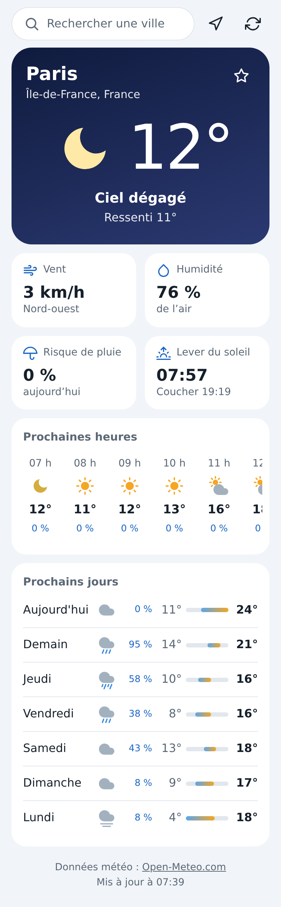
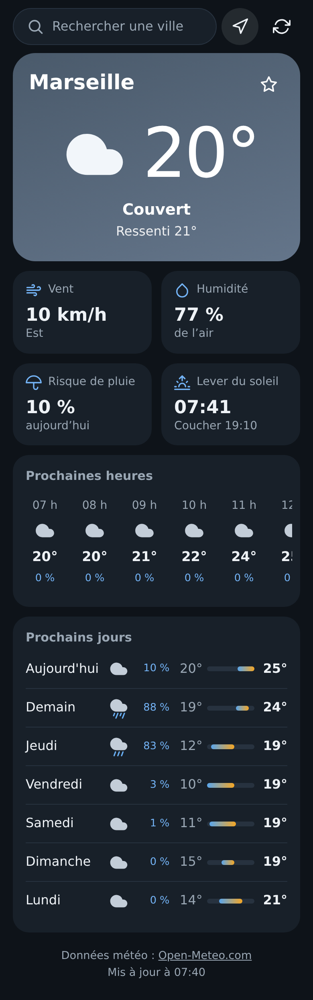

# Météo

Application météo pour Android, en français, sans compte, sans publicité et
sans traceur. Les données viennent d'[Open-Meteo](https://open-meteo.com/),
un service gratuit qui ne demande aucune clé.

<p>
  
  
</p>

## Ce que fait l'appli

- Recherche de n'importe quelle ville, avec favoris.
- Météo de l'endroit où l'on se trouve (position approximative).
- Conditions actuelles : température, ressenti, état du ciel, vent, humidité,
  risque de pluie, lever et coucher du soleil.
- Prévisions des 24 prochaines heures et des 7 prochains jours.
- Thème clair ou sombre selon le réglage du téléphone.
- Sans réseau, les dernières données reçues restent affichées avec leur heure.

## Installation

1. Télécharger `meteo.apk` depuis la page
   [Releases](https://github.com/ManBoyx/meteo-apk/releases).
2. Ouvrir le fichier sur le téléphone et autoriser l'installation depuis
   cette source.

Android 8.0 ou plus récent. L'APK pèse environ 34 Ko.

## Vie privée

L'appli demande deux autorisations : Internet et position approximative.
La position est facultative ; si elle est refusée, la recherche de ville
suffit. Les seules données qui quittent le téléphone sont les coordonnées du
lieu (arrondies à environ 1 km) et le texte de la recherche, envoyés à
Open-Meteo. Les favoris et la dernière ville restent sur le téléphone.

## Comment c'est fait

Une petite coque Java (une activité, un WebView, un pont pour la position)
affiche une page HTML/CSS/JS embarquée dans l'APK. Aucune bibliothèque
externe, ni côté Android ni côté JavaScript.

```
app/src/main/
  java/fr/manboyx/meteo/   coque Android
  assets/                  la page
    js/api.js              appels à Open-Meteo
    js/meteo.js            interprétation et mise en forme des données
    js/stockage.js         mémoire locale (ville, favoris, dernières données)
    js/vue.js              rendu de l'écran
    js/app.js              enchaînement et événements
tests/                     tests des modules JavaScript
```

## Compiler

Il faut Java 17 et le SDK Android (plateforme 36).

```sh
export ANDROID_HOME=/chemin/vers/android-sdk
./gradlew assembleRelease
```

L'APK sort dans `app/build/outputs/apk/release/`. Sans clé de signature il
n'est pas signé ; pour le signer, créer `signature/meteo.jks` (alias `meteo`)
et `signature/cle.properties` contenant `motDePasse=...`. Ce dossier n'est
pas suivi par git.

## Tests

```sh
node --test tests/
```

Node 18 ou plus récent, sans dépendance à installer.

## Données

Données météo et géocodage : [Open-Meteo.com](https://open-meteo.com/),
sous licence [CC BY 4.0](https://creativecommons.org/licenses/by/4.0/).
